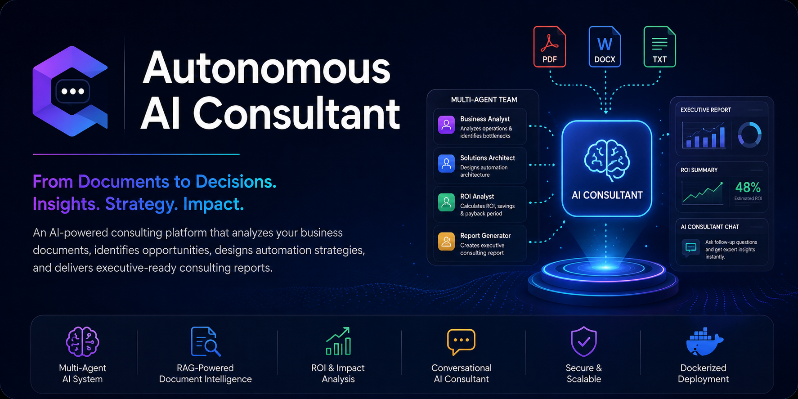
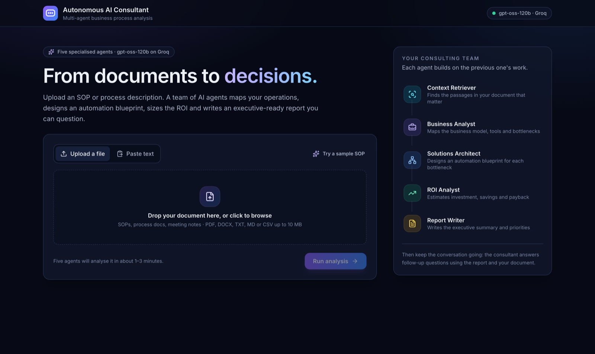
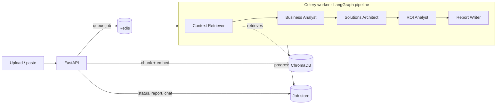

# 🤖 Autonomous AI Consultant

A multi-agent AI consulting platform that turns operational documents (SOPs, process docs, meeting notes) into a current-state analysis, an automation blueprint, an ROI estimate and an executive report — then lets you question the consultant about it.

Built with **LangGraph**, **FastAPI**, **Celery**, **Redis**, **ChromaDB** and **React**, running on **`openai/gpt-oss-120b` via Groq**.



---

## ✨ Features

- **Multi-format input**: upload a PDF, DOCX, TXT, MD or CSV file, or paste text. There's a built-in sample SOP for trying it out.
- **Five specialised agents** in a LangGraph pipeline, each building on the previous one's output (see below).
- **Live progress**: the UI shows which agent is working, which are done and where a run failed.
- **Structured, validated outputs**: every agent returns a Pydantic schema, enforced by Groq's strict JSON-schema mode.
- **Consistent financials**: the ROI agent estimates cost and savings; payback period and 3-year ROI are calculated in code, so the numbers always agree.
- **Grounded follow-up chat**: the consultant answers using the report plus the most relevant passages of your document, and remembers the conversation.
- **Persistent jobs**: reports and chat history survive restarts, and every report has a shareable URL (`?job=<id>`).
- **Export**: download the report as Markdown or print it to PDF (light, print-friendly layout).

## 🧠 How it works



| Agent | What it does |
| --- | --- |
| **Context Retriever** | Sends the whole document to the analyst if it fits the context budget; otherwise runs four targeted searches (business model, tools, manual processes, volumes/costs) and assembles the best chunks in document order. |
| **Business Analyst** | Extracts the business model, current tools and every bottleneck with hours per week. |
| **Solutions Architect** | Designs one automation solution per bottleneck, with a tech stack and implementation steps. |
| **ROI Analyst** | Estimates build cost, hours saved and annual savings **for the proposed architecture**, and lists its assumptions. |
| **Report Writer** | Writes the executive summary and 3–5 priority actions. |

The pipeline stops at the first agent that fails, and the error is shown in the UI with the failing step highlighted.

## ⚙️ Tech stack

| Layer | Tools |
| --- | --- |
| LLM | `openai/gpt-oss-120b` on [Groq](https://console.groq.com) via `langchain-groq` |
| Orchestration | LangGraph |
| API & jobs | FastAPI, Celery, Redis |
| Retrieval | ChromaDB with local `all-MiniLM-L6-v2` embeddings (no embedding API key needed) |
| Frontend | React, Vite, Tailwind CSS, lucide-react |
| Infrastructure | Docker Compose (API, worker, Redis, Chroma server, frontend) |

## 🚀 Quick start (Docker)

1. Get a free API key from [console.groq.com/keys](https://console.groq.com/keys).
2. Create your `.env` and add the key:

   ```bash
   cp .env.example .env
   # then edit .env and set GROQ_API_KEY=...
   ```

3. Start everything:

   ```bash
   docker compose up --build
   ```

4. Open **http://localhost:3001**. The API runs on http://localhost:8000 (interactive docs at `/docs`).

## 🛠 Local development (without Docker)

Requires Python 3.10+, Node 18+ and Redis.

```bash
# Backend
python -m venv .venv && source .venv/bin/activate
pip install -r requirements-dev.txt
cp .env.example .env            # add your GROQ_API_KEY

redis-server                                                        # terminal 1
uvicorn app.main:app --reload --port 8000                           # terminal 2
celery -A app.celery_worker.celery_app worker --loglevel=info --pool=solo   # terminal 3

# Frontend (terminal 4)
cd frontend && npm install && npm run dev                           # http://localhost:5173
```

Without `CHROMA_HOST`, the backend uses an embedded ChromaDB in `data/chroma`. Job records live in `data/jobs`.

## 🔧 Configuration

All settings are environment variables (see `.env.example`).

| Variable | Default | Purpose |
| --- | --- | --- |
| `GROQ_API_KEY` | — | **Required.** Groq API key. |
| `GROQ_MODEL` | `openai/gpt-oss-120b` | Model used by every agent and the chat. |
| `GROQ_REASONING_EFFORT` | `medium` | `low`, `medium` or `high`. |
| `MAX_CONTEXT_CHARS` | `12000` | How much of the document the analyst reads. Groq's free tier allows 8K tokens/minute for gpt-oss-120b, so keep this low there and raise it on a paid plan. |
| `MAX_DOCUMENT_CHARS` | `150000` | Longer documents are truncated. |
| `MAX_UPLOAD_MB` | `10` | Upload size limit. |
| `CELERY_BROKER_URL` / `CELERY_RESULT_BACKEND` | `redis://localhost:6379/0` and `/1` | Redis connections. |
| `CHROMA_HOST` / `CHROMA_PORT` | embedded / `8000` | Set to use a Chroma server (Docker Compose does). |
| `DATA_DIR` | `./data` | Job records and the embedded Chroma DB. |
| `CORS_ORIGINS` | `http://localhost:3001,http://localhost:5173` | Allowed frontend origins. |

> **Groq free tier:** runs make 4 LLM calls and may pause briefly for rate limits; the Groq SDK retries automatically using the `retry-after` header. A typical run takes 1–3 minutes.

## 📡 API

| Method | Endpoint | Description |
| --- | --- | --- |
| `GET` | `/api/v1/health` | API, worker and LLM configuration status |
| `POST` | `/api/v1/upload` | Upload a document (multipart `file`) and start a job |
| `POST` | `/api/v1/consult` | Start a job from pasted text (`{"document_text": "..."}`) |
| `GET` | `/api/v1/consult/{job_id}` | Status, per-agent progress, results and chat history |
| `GET` | `/api/v1/consult/{job_id}/report` | The finished report as Markdown |
| `POST` | `/api/v1/consult/{job_id}/chat` | Ask a follow-up question (`{"question": "..."}`) |

## 📂 Project structure

```
app/
├── main.py            FastAPI endpoints
├── celery_worker.py   Celery app + task that runs the pipeline and records progress
├── graph.py           LangGraph workflow (sequential, stops on first failure)
├── nodes.py           The five agents
├── prompts.py         Agent and consultant prompts
├── schemas.py         Pydantic output schemas + ROI calculation
├── state.py           Shared LangGraph state
├── llm.py             Groq model setup and friendly error messages
├── vector_store.py    Chunking, local embeddings and retrieval (ChromaDB)
├── documents.py       PDF/DOCX/TXT extraction and clean-up
├── storage.py         Durable JSON job records (status, results, chat)
├── advisor.py         Follow-up chat grounded in the report + document
├── report.py          Markdown report rendering
└── config.py          Settings from environment variables
frontend/src/
├── App.jsx            Views: landing, live progress, failure, report + chat
├── components/        DocumentInput, AgentPipeline, ReportView, ChatPanel, ...
└── lib/               API client, agent definitions, formatting, sample SOP
tests/                 pytest suite (graph wiring, pipeline, API, retrieval, parsing)
```

## ✅ Tests

```bash
pip install -r requirements-dev.txt
pytest
```

The suite runs the full pipeline with a fake LLM, so it needs no API key.

## 📈 Roadmap

- Streaming chat responses
- Multi-document engagements
- Authentication and per-user workspaces
- Industry benchmarks for the ROI estimates
- Human review step before the final report

---

## 👨‍💻 Author

**Varad Adhyapak** · Computer Science (AI & ML)

Interested in AI engineering, agentic AI, backend systems, LLM infrastructure and distributed systems.

⭐ If you found this project interesting, consider giving it a star!
